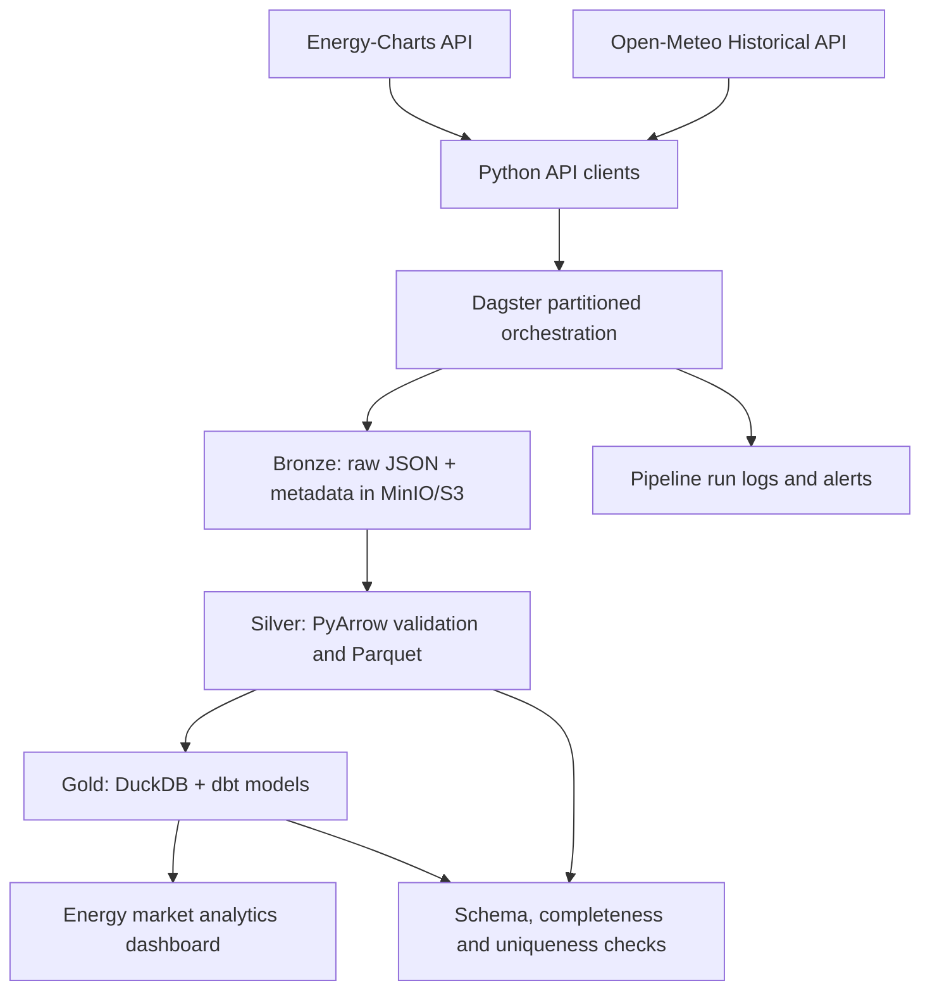

# GridFlow — Technical Architecture (Planned)

## Data flow

## Initial stack

- **Python 3.12+** with httpx for API ingestion and PyArrow for columnar processing
- **Dagster** for asset dependencies, schedules and partition backfills
- **Docker Compose + MinIO** for local, S3-compatible object storage
- **Parquet** partitioned by market/source/date
- **DuckDB + dbt-duckdb** for local analytics transformations
- **GitHub Actions + pytest + Ruff** for CI
- **Optional AWS S3** after the local system runs reliably

## Storage contracts

| Layer | Path or table | Key characteristics |
|---|---|---|
| Bronze | `bronze/source=<source>/market=<zone>/date=YYYY-MM-DD/` | Original API response, parameters, request time, checksum |
| Silver | `silver/prices/market=<zone>/date=YYYY-MM-DD/*.parquet` | Typed UTC interval timestamps, duration, units, clean market IDs |
| Silver | `silver/weather/location=<id>/date=YYYY-MM-DD/*.parquet` | Typed weather variables and UTC timestamps |
| Gold | `fact_day_ahead_prices` | Unique source, market, interval, version |
| Gold | `mart_market_daily` | Market-local date summary with explicit price methodology |

## Important correctness decisions

**Market time zones:** store UTC timestamps and the original market time zone separately. Europe has daylight-saving transitions, and intervals must be processed based on actual duration rather than assumed 24-hour days.

**Mixed interval lengths:** retain delivery interval start and end (or duration) instead of assuming one hour. Compute energy-weighted quantities only when appropriate.

**Source revisions:** keep raw versions and their fetch time. Refresh the affected Silver/Gold partition rather than appending duplicates.

**Weather joins:** document the reference location and how hourly weather observations are matched to power-price intervals. No causal claim is implied.

**Observability:** capture request errors, HTTP 429 and retry handling, partition completeness, freshness, validation failures and processing duration.

## Scope boundaries

This is a data-engineering portfolio platform, not a power trading strategy. Streaming, Spark, Kafka, Kubernetes and model forecasting are not part of the first milestone. No live production deployment is claimed.
